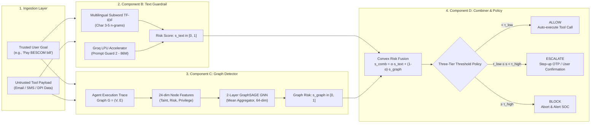

# AgentGuard-IN: Methodology & Architecture Overview

This document presents the methodology architecture diagram and execution pipeline for **AgentGuard-IN: Dual-Modality Guardrails for Tool-Using AI Agents Against Indirect Prompt Injection in Indian Digital Public Infrastructure**.

---

## 1. High-Resolution Methodology Diagram

The methodology diagram illustrates the four-stage layered defense architecture:
1. **Multimodal Ingestion Layer**: Distinguishes between trusted user intent and untrusted third-party tool outputs (emails, PDFs, VPA handles).
2. **Component B (Text Guardrail)**: Pre-execution subword character n-gram screening and Groq LPU-accelerated Meta Prompt Guard 2 scoring.
3. **Component C (Graph Detector)**: GraphSAGE trajectory anomaly detector tracking 24-dimensional causal node features and information-flow edges.
4. **Component D (Layered Combiner & Triage Engine)**: Convex fusion scoring with asymmetric three-tier policy enforcement (**ALLOW**, **ESCALATE**, **BLOCK**).

---

## 2. Methodology Component Breakdown

---

## 3. Detailed Stage Walkthrough

### Stage 1: Dual-Source Input & Ingestion Layer
* **User Goal**: Natural language instructions entered by the operator with verified user credentials.
* **Untrusted External Data**: Dynamic payloads retrieved via read tools (e.g., email inbox retrieval, PDF attachments, SMS messages, merchant QR data).
* **Cross-Lingual Threat Model**: Supports English, Hindi (Devanagari & Latin transliterated), and Kannada injection vectors targeting Indian DPI workflows (UPI, DigiLocker, Account Aggregator, CoWIN).

### Stage 2: Component B — Pre-Execution Text Guardrail
* **Subword Classifier**: Uses character 3-5 n-grams with sublinear TF-IDF term weighting and calibrated MaxEnt/Logistic regression to capture morphologically rich Indic word boundaries and phonetically spelled attack tokens without requiring massive GPU checkpoints.
* **Cloud LPU Classifier**: Groq API integration hosting Meta Prompt Guard 2 (`meta-llama/llama-prompt-guard-2-86m`) providing ultra-fast 3.2 ms classification.
* **Output**: Continuous text risk score $s_{\text{text}} \in [0.0, 1.0]$.

### Stage 3: Component C — Runtime Trajectory Graph Anomaly Detector
* **Graph Formalism**: Models the entire agent execution as a directed information-flow multigraph $G = (V, E)$ where nodes $V$ represent User Goals, Agent Thoughts, Tool Invocations, and Environment Observations; edges $E$ track data provenance, causal influence, and sequence order.
* **24-Dimensional Node Vectors**: Encodes node category one-hot, privilege tier (Safe, Read-Only, Privileged Financial/Identity), raw lexical risk score, and taintedness flags.
* **GNN Backbone**: 2-layer GraphSAGE inductive graph neural network with mean neighborhood aggregation, hidden dimension 64, ReLU activation, and a global mean-pooling classifier.
* **Output**: Continuous graph-level anomaly probability $s_{\text{graph}} \in [0.0, 1.0]$.

### Stage 4: Component D — Layered Fusion & Asymmetric Triage Engine
* **Convex Fusion Rule**: Combines pre-execution lexical screening and runtime trajectory signals:
  $$s_{\text{comb}} = \alpha \cdot s_{\text{text}} + (1 - \alpha) \cdot s_{\text{graph}}$$
  where $\alpha = 0.40$ (favoring graph topology for complex multi-turn attacks).
* **Three-Tier Policy Triage**:
  - **$\text{ALLOW} \quad (s_{\text{comb}} < 0.20)$**: Zero friction for benign workflows.
  - **$\text{ESCALATE} \quad (0.20 \le s_{\text{comb}} < 0.85)$**: Suspicious payloads require human-in-the-loop authorization (e.g., UPI step-up MPIN / SMS OTP) before execution.
  - **$\text{BLOCK} \quad (s_{\text{comb}} \ge 0.85)$**: Direct exploitation attempts are immediately severed, generating security telemetry.

---

## 4. File Locations in Repository

| Asset | Format | Location | Purpose |
| :--- | :--- | :--- | :--- |
| **Methodology Figure (Raster)** | PNG (300 DPI) | [`paper/figures/methodology.png`](file:///e:/NEW/agentguard_in/paper/figures/methodology.png) | High-res image for slide decks and presentations |
| **Methodology Figure (Vector)** | PDF | [`paper/figures/methodology.pdf`](file:///e:/NEW/agentguard_in/paper/figures/methodology.pdf) | Crisp vector graphic directly embedded in `paper/main.tex` |
| **Figure Generator Script** | Python (Matplotlib) | [`scripts/generate_methodology_figure.py`](file:///e:/NEW/agentguard_in/scripts/generate_methodology_figure.py) | Fully reproducible script to re-render or adjust styling |
| **IEEE Conference Paper** | LaTeX | [`paper/main.tex`](file:///e:/NEW/agentguard_in/paper/main.tex) | Complete IEEEtran manuscript referencing `methodology.pdf` |
| **Bibliography** | BibTeX | [`paper/references.bib`](file:///e:/NEW/agentguard_in/paper/references.bib) | Complete citations for all 20 literature benchmark papers |
